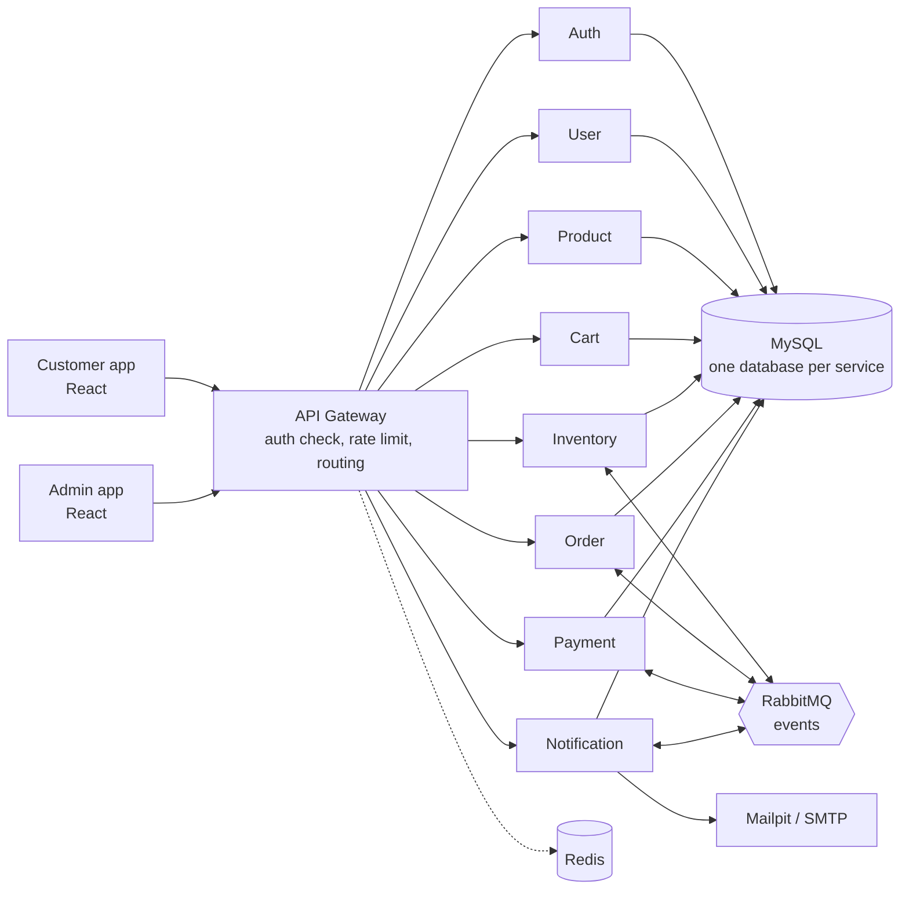

# Cloud-Native Cake Shop Platform

[](https://github.com/AlexBhai14/cake-shop-platform/actions/workflows/ci-cd.yml)

A microservices-based e-commerce platform for an online cake shop, built as an **MSc IT final-year project**.
Customers browse and customize cakes, choose a delivery date and time slot, pay through a **mock payment gateway**, and track their orders.
Administrators manage cakes, stock, delivery slots, orders and customers.

> **Payments are fully simulated. No real money, card or bank is involved anywhere in this project.**

## Architecture at a glance



Every service owns its own database. Services talk through REST (queries) and RabbitMQ events (the checkout saga).
Details: [`docs/architecture/ARCHITECTURE.md`](docs/architecture/ARCHITECTURE.md).

## Technology

| Area | Technology |
|---|---|
| Frontend | React 18, TypeScript, Tailwind CSS, React Router, Axios, Vite, Vitest |
| Backend | Node.js 22, TypeScript, NestJS 10 (modules, dependency injection, guards) |
| Database | MySQL 8.4, Prisma ORM + Prisma Migrate (database per service) |
| Security | Passport.js, JWT access tokens, rotating refresh tokens, bcrypt, role-based access control, validation, Helmet |
| Messaging | RabbitMQ (topic exchange, retry queues, dead letter queues), Redis (rate limiting) |
| Patterns | Saga (orchestration), transactional outbox, idempotent consumers, idempotency keys, reconciliation |
| Testing | Jest, Supertest, Testcontainers, Vitest + Testing Library, end-to-end suite |
| DevOps | Docker (multi-stage), Docker Compose, Kubernetes (Kustomize), GitHub Actions, Docker Hub |
| Observability | Prometheus, Grafana, structured JSON logs, correlation ids, health endpoints |

## Services

| Service | Port | Responsibility |
|---|---|---|
| api-gateway | 3000 | Single entry point: JWT check, Redis rate limiting, CORS, routing, correlation ids |
| auth-service | 3001 | Registration, login, JWT, refresh-token rotation, roles, account status |
| user-service | 3002 | Profiles and delivery addresses |
| product-service | 3003 | Categories, cakes, variants (flavour, size, eggless), prices, search |
| cart-service | 3004 | Cart with live price validation (no stale prices) |
| inventory-service | 3005 | Stock, reservations, delivery-slot capacity, history |
| order-service | 3006 | Checkout saga, order state machine, tracking, analytics |
| payment-service | 3007 | MOCK payments: success, failure, timeout, refunds |
| notification-service | 3008 | Email notifications (Mailpit in development) |
| customer-app | 5173 | Shop front end |
| admin-app | 5174 | Admin panel |

## Quick start (Docker Compose, local development)

Requirements: Docker Desktop, Node.js 22 or newer, Git.

```powershell
git clone https://github.com/AlexBhai14/cake-shop-platform.git
cd cake-shop-platform
Copy-Item .env.example .env        # then change every password in .env
docker compose up -d mysql redis rabbitmq mailpit
```

Then, for each backend service folder: `Copy-Item .env.example .env`, `npm install`, `npx prisma migrate dev --name init`, `npm run start:dev`.
Create the admin account with `npm run seed` in `backend/auth-service`, the demo cakes with `npm run seed` in `backend/product-service`,
and start the two React apps with `npm run dev` (customer http://localhost:5173, admin http://localhost:5174).
The complete step-by-step guides are the `SETUP_BATCH*.md` files in the repository root.

To run everything in containers: `docker compose up -d --build`.

## Useful URLs (local)

| What | URL |
|---|---|
| Customer shop | http://localhost:5173 |
| Admin panel | http://localhost:5174 |
| API Gateway | http://localhost:3000 |
| Test inbox (Mailpit) | http://localhost:8025 |
| RabbitMQ management | http://localhost:15672 |
| Prometheus | http://localhost:9090 |
| Grafana | http://localhost:3030 |

## How checkout works (saga)

1. The order service stores the order (`PENDING_PAYMENT`) and an `OrderCreated` event in ONE transaction (transactional outbox).
2. The inventory service reserves stock and delivery-slot capacity, then publishes `StockReserved` (or `StockReservationFailed`).
3. The order service asks for payment (`PaymentRequested`); the payment service creates a payment the customer completes (simulated).
4. `PaymentSucceeded` confirms the order; `PaymentFailed` cancels it. Cancellation releases the reservation (compensation) and a paid order is refunded.
5. The notification service sends the emails. Unknown payment results are resolved by reconciliation jobs.

Every consumer is idempotent, because RabbitMQ delivers at least once.

## Testing

| Level | Command |
|---|---|
| Unit (per service) | `npm test` in a service folder |
| Integration, real MySQL (Testcontainers) | `npm run test:int` in `backend/inventory-service` |
| End to end, through the gateway | `npm test` in `tests/e2e` |
| Load test | see `tests/performance/load-test.js` |

Strategy and how to run each level: [`docs/learning-notes/TESTING.md`](docs/learning-notes/TESTING.md).

## Deployment

- **Docker Compose:** `docker-compose.yml` (development stack with monitoring).
- **Kubernetes:** `infrastructure/kubernetes` (Kustomize base + overlays), guide in [`docs/learning-notes/KUBERNETES.md`](docs/learning-notes/KUBERNETES.md).
- **CI/CD:** `.github/workflows/ci-cd.yml`: lint, tests, image build, Docker Hub, approved deployment, smoke test, automatic rollback. Guide: [`docs/ci-cd/CI_CD.md`](docs/ci-cd/CI_CD.md).

## Security

Passwords are hashed with bcrypt, never stored in plain text. Authorization is enforced by the backend on every request (401/403); the frontend only hides pages.
Secrets never enter Git (`.env` is ignored, Kubernetes secrets are created from the local `.env`, CI uses GitHub Secrets).
Security review and known limitations: [`docs/SECURITY_REVIEW.md`](docs/SECURITY_REVIEW.md).

## Documentation

| Document | Content |
|---|---|
| [`docs/architecture/ARCHITECTURE.md`](docs/architecture/ARCHITECTURE.md) | Architecture, data ownership, saga, decisions |
| [`docs/api-documentation/API.md`](docs/api-documentation/API.md) | REST API reference |
| [`docs/api-documentation/EVENTS.md`](docs/api-documentation/EVENTS.md) | Event contracts |
| [`database/documentation/DATABASE.md`](database/documentation/DATABASE.md) | Database design |
| [`docs/learning-notes/`](docs/learning-notes) | Concept notes for revision |
| [`docs/project-report/MSC_PROJECT_REPORT.md`](docs/project-report/MSC_PROJECT_REPORT.md) | MSc IT project report |

## Project layout

```
backend/            9 NestJS services (each: src, prisma, tests, Dockerfile)
frontend/           customer-app, admin-app (React)
infrastructure/     kubernetes, monitoring (Prometheus, Grafana), rabbitmq, mysql init
tests/              e2e, performance
scripts/            helper scripts (images, secrets, CI)
docs/               architecture, API, learning notes, report
.github/workflows/  CI/CD
```

## Project status
PS D:\Sahil_Code\Project\cake-shop-platform-FULL\cake-shop-platform> 3000..3008 | ForEach-Object { "$_ -> " + (curl.exe -s -o NUL -w "%{http_code}" "http://localhost:$_/health") }  


3000..3008 | ForEach-Object { "$_ -> " + (curl.exe -s -o NUL -w "%{http_code}" "http://localhost:$_/health") }  


All nine backend services, both front ends, the Kubernetes manifests, monitoring and the CI/CD pipeline are implemented.
The real results of the test runs and of the load test on the author's machine are recorded in the project report (chapter 8).
