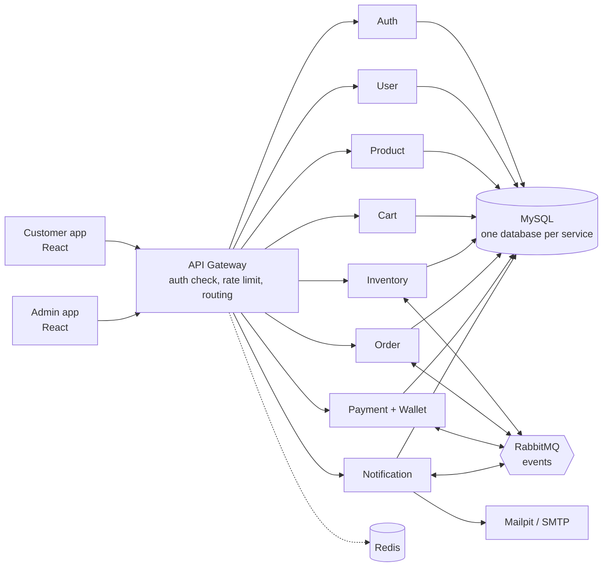

# Cloud-Native Cake Shop Platform

[](https://github.com/AlexBhai14/cake-shop-platform/actions/workflows/ci-cd.yml)

A microservices-based e-commerce platform for an online cake shop, built as an **MSc IT final-year project**.
Customers browse and customize cakes, choose a delivery date and time slot, pay through a **mock payment gateway or a mock wallet**, and track their orders.
Administrators manage cakes, discounts, stock, delivery slots, orders and customers.

> **Payments and the wallet are fully simulated. No real money, card or bank is involved anywhere in this project.**

## Architecture at a glance



Every service owns its own database. Services talk through REST (queries) and RabbitMQ events (the checkout saga).
Details: [`docs/architecture/ARCHITECTURE.md`](docs/architecture/ARCHITECTURE.md).

## Features

**Customer app:** home, categories, search and filters, cake details with customization (flavour, size, eggless or regular, message on the cake),
cart with live prices, checkout with address, delivery date and time slot, mock payment (simulated bank **or wallet**), order tracking, order history, profile, **wallet** (balance and history).
Discounted cakes show a crossed-out price, a "% OFF" badge and a "You saved" line in the cart and at checkout.

**Admin app:** dashboard with **recent activity**, **live pop-up alerts for new paid orders**, order management with a controlled status flow,
cake and category management (including the discount shown in the shop), inventory and delivery-slot capacity, customers, mock payments and refunds, analytics.

**Platform:** JWT authentication with refresh-token rotation, role-based access control (CUSTOMER, ADMIN), Redis rate limiting,
checkout saga with compensation, transactional outbox, idempotent consumers, Prometheus and Grafana monitoring.

## Technology

| Area | Technology |
|---|---|
| Frontend | React 18, TypeScript, Tailwind CSS, React Router, Axios, Vite, Vitest |
| Backend | Node.js 22, TypeScript, NestJS 10 (modules, dependency injection, guards) |
| Database | MySQL 8.4, Prisma ORM + Prisma Migrate (database per service) |
| Security | Passport.js, JWT access tokens, rotating refresh tokens, bcrypt, role-based access control, validation, Helmet |
| Messaging | RabbitMQ (topic exchange, retry queues, dead letter queues), Redis (rate limiting) |
| Patterns | Saga (orchestration), transactional outbox, idempotent consumers, idempotency keys, reconciliation |
| Testing | Jest, Supertest, Testcontainers, Vitest + Testing Library, end-to-end suite |
| DevOps | Docker (multi-stage), Docker Compose, Kubernetes (Kustomize), GitHub Actions, Docker Hub |
| Observability | Prometheus, Grafana, structured JSON logs, correlation ids, health endpoints |

## Services

| Service | Port | Responsibility |
|---|---|---|
| api-gateway | 3000 | Single entry point: JWT check, Redis rate limiting, CORS, routing, correlation ids |
| auth-service | 3001 | Registration, login, JWT, refresh-token rotation, roles, account status |
| user-service | 3002 | Profiles and delivery addresses |
| product-service | 3003 | Categories, cakes, variants (flavour, size, eggless), prices, discount display, search |
| cart-service | 3004 | Cart with live price validation (no stale prices) and display-only savings |
| inventory-service | 3005 | Stock, reservations, delivery-slot capacity, history |
| order-service | 3006 | Checkout saga, order state machine, tracking, analytics |
| payment-service | 3007 | MOCK payments (success, failure, timeout), refunds, MOCK wallet |
| notification-service | 3008 | Email notifications (Mailpit in development) |
| customer-app | 5173 | Shop front end |
| admin-app | 5174 | Admin panel |

## Quick start

Requirements: Docker Desktop (running), Node.js 22 or newer, Git, VS Code.

```powershell
git clone https://github.com/AlexBhai14/cake-shop-platform.git
cd cake-shop-platform
Copy-Item .env.example .env        

# then change the passwords in .env
docker compose up -d mysql redis rabbitmq mailpit
powershell -ExecutionPolicy Bypass -File scripts\setup-local.ps1     # first time only
powershell -ExecutionPolicy Bypass -File scripts\start-all.ps1
```

The full guide (daily start, safe stop, first order walkthrough, troubleshooting) is [`RUN_ME_FIRST.md`](RUN_ME_FIRST.md).
Tests, monitoring, Kubernetes and CI/CD steps are in [`SETUP.md`](SETUP.md).

## Useful URLs (local)

| What | URL |
|---|---|
| Customer shop | http://localhost:5173 |
| Admin panel | http://localhost:5174 |
| API Gateway health | http://localhost:3000/health |
| Test inbox (Mailpit) | http://localhost:8025 |
| RabbitMQ management | http://localhost:15672 |
| Prometheus | http://localhost:9090 |
| Grafana | http://localhost:3030 |

## How checkout works (saga)

1. The order service stores the order (`PENDING_PAYMENT`) and an `OrderCreated` event in ONE transaction (transactional outbox).
2. The inventory service reserves stock and delivery-slot capacity, then publishes `StockReserved` (or `StockReservationFailed`).
3. The order service asks for payment (`PaymentRequested`); the payment service creates a payment that the customer completes (simulated bank or wallet).
4. `PaymentSucceeded` confirms the order; `PaymentFailed` cancels it. Cancellation releases the reservation (compensation) and a paid order is refunded **to the customer's wallet**.
5. The notification service sends the emails. Unknown payment results are resolved by reconciliation jobs.

Every consumer is idempotent, because RabbitMQ delivers at least once.
Rules added later: a **delivered order cannot be refunded**; the wallet balance check and subtraction are one atomic database statement, so the same money cannot be spent twice.

## Testing

| Level | Command |
|---|---|
| Unit (per service or app) | `npm test` in the service or app folder |
| Integration, real MySQL (Testcontainers) | `npm run test:int` in `backend/inventory-service` |
| End to end, through the gateway | `npm test` in `tests/e2e` |
| Load test | see `tests/performance/load-test.js` |

Strategy and how to run each level: [`docs/learning-notes/TESTING.md`](docs/learning-notes/TESTING.md).

## Deployment

- **Docker Compose:** `docker-compose.yml` (development stack with monitoring).
- **Kubernetes:** `infrastructure/kubernetes` (Kustomize base + overlays). Steps in [`SETUP.md`](SETUP.md), concepts in [`docs/learning-notes/KUBERNETES.md`](docs/learning-notes/KUBERNETES.md).
- **CI/CD:** `.github/workflows/ci-cd.yml`: lint, tests, image build, Docker Hub, approved deployment, smoke test, automatic rollback. Guide: [`docs/ci-cd/CI_CD.md`](docs/ci-cd/CI_CD.md).

## Security

Passwords are hashed with bcrypt, never stored in plain text. Authorization is enforced by the backend on every request (401/403); the frontend only hides pages.
Secrets never enter Git (`.env` is ignored, Kubernetes secrets are created from the local `.env`, CI uses GitHub Secrets).
Security review and known limitations: [`docs/SECURITY_REVIEW.md`](docs/SECURITY_REVIEW.md).

## Documentation

| Document | Content |
|---|---|
| [`RUN_ME_FIRST.md`](RUN_ME_FIRST.md) | Set up, run, stop and troubleshoot the project |
| [`SETUP.md`](SETUP.md) | Tests, monitoring, end-to-end tests, Kubernetes, CI/CD |
| [`docs/architecture/ARCHITECTURE.md`](docs/architecture/ARCHITECTURE.md) | Architecture, data ownership, saga, decisions |
| [`docs/api-documentation/API.md`](docs/api-documentation/API.md) | REST API reference |
| [`docs/api-documentation/EVENTS.md`](docs/api-documentation/EVENTS.md) | Event contracts |
| [`database/documentation/DATABASE.md`](database/documentation/DATABASE.md) | Database design |
| [`docs/learning-notes/`](docs/learning-notes) | Concept notes for revision |
| [`docs/project-report/MSC_PROJECT_REPORT.md`](docs/project-report/MSC_PROJECT_REPORT.md) | MSc IT project report |

## Project layout

```
backend/            9 NestJS services (each: src, prisma, tests, Dockerfile)
frontend/           customer-app, admin-app (React)
infrastructure/     kubernetes, monitoring (Prometheus, Grafana), rabbitmq, mysql init
tests/              e2e, performance
scripts/            helper scripts (setup, start, images, secrets, CI)
docs/               architecture, API, learning notes, report
.github/workflows/  CI/CD
```

## Recent updates (November 2026)

- **Refund fix:** a delivered order can no longer be refunded (payment service learns about delivery from the `OrderStatusChanged` event; the refund API answers 409; the admin app hides the button).
- **Customer wallet (mock):** refunds are credited to the wallet in the same database transaction as the refund. API: `GET /api/payments/wallet`, `GET /api/payments/wallet/transactions`.
- **Pay with wallet:** `POST /api/payments/orders/:orderId/pay-with-wallet`. Safe to call twice (never charges twice); 400 when the balance is too small.
- **Discount display:** the admin sets the real price and a discount percent per cake; the shop shows `price / (1 - discount)` crossed out. Display only: carts, orders and payments always use the real price.
- **Cart and checkout:** crossed-out prices and a "You saved" line.
- **Admin:** live pop-up for every new paid order (polling every 15 seconds), "Recent activity" on the dashboard. The "Emails" page was removed from the admin panel (customers still receive their emails).
- Details: [`docs/api-documentation/API.md`](docs/api-documentation/API.md), [`docs/api-documentation/EVENTS.md`](docs/api-documentation/EVENTS.md), [`database/documentation/DATABASE.md`](database/documentation/DATABASE.md).

## Project status

All nine backend services and both front ends are implemented and run locally with Docker Compose; the unit and component tests of every service pass on the author's machine.
The Kubernetes manifests, monitoring and the CI/CD pipeline are prepared in the repository; running them on a cluster and enabling the pipeline is the next step (see [`SETUP.md`](SETUP.md)).
Results of the test runs and of the load test are recorded in the project report (chapter 8).
