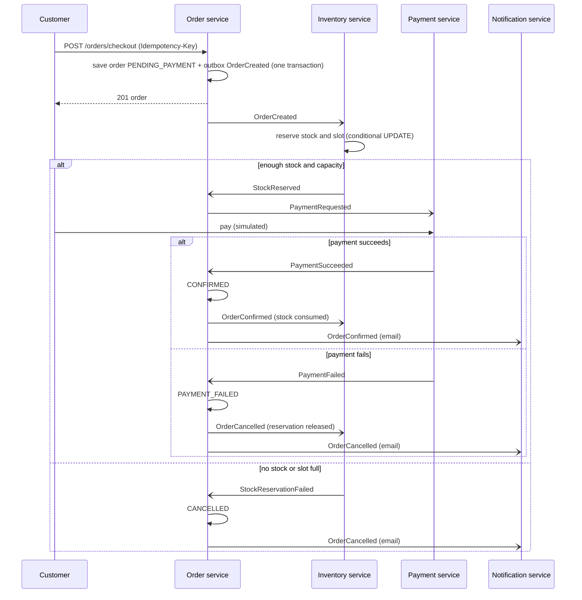

# Architecture

## 1. Goals
A realistic, scalable and secure online cake shop that shows how companies build with microservices: independent services,
asynchronous communication, reliable distributed transactions without distributed database transactions, container deployment,
automated pipelines and observability.

## 2. Containers and responsibilities

| Container | Owns | Talks to |
|---|---|---|
| API Gateway | no business data | all services (REST), Redis (rate limits) |
| Auth | users, refresh tokens | MySQL `cake_auth_db` |
| User | profiles, addresses | `cake_user_db` |
| Product | categories, cakes, variants | `cake_product_db` |
| Cart | carts, cart items (no prices) | `cake_cart_db`, product (REST) |
| Inventory | stock, movements, slot capacity, reservations | `cake_inventory_db`, RabbitMQ |
| Order | orders, items, history, outbox | `cake_order_db`, RabbitMQ, cart and user (REST) |
| Payment | payments, transactions | `cake_payment_db`, RabbitMQ |
| Notification | emails | `cake_notification_db`, RabbitMQ, SMTP |

Rules: a service never reads another service's tables; there are no cross-service foreign keys (ids such as `userId` are plain values);
each service has its own database user with rights on its own database only.

## 3. Communication

- **REST (synchronous)** for questions that need an answer now: the cart asks the product service for the current price; the order service reads the cart and the address.
- **Events (asynchronous)** through one topic exchange `cake.events` for the checkout. Each consuming service has a queue `<service>.events` with a retry queue (delay, then back) and a dead letter queue after 3 failures.
- **Event contract:** a versioned envelope (`eventId`, `type`, `version`, `occurredAt`, `correlationId`, `data`). See `docs/api-documentation/EVENTS.md`.

## 4. The checkout saga



## 5. Reliability techniques

| Problem | Technique |
|---|---|
| A crash between "save order" and "publish event" | **Transactional outbox**: the event is written in the same database transaction; a publisher sends it later |
| RabbitMQ delivers a message twice | **Idempotent consumers**: the event id is stored in the same transaction as the work |
| Two customers buy the last cake | Conditional `UPDATE ... WHERE onHand - reserved >= qty` under a row lock (proved by the Testcontainers test) |
| A customer double-clicks "place order" | `Idempotency-Key` header with a unique constraint |
| A payment result never arrives (timeout) | Status `UNKNOWN`, **reconciliation** job asks the (mock) bank again; orders stuck in `PENDING_PAYMENT` are cancelled after a timeout |
| Payment succeeds after the order was cancelled | The order service answers with `RefundRequested` |
| A failing handler | Retry queue with delay, then dead letter queue (alert in Prometheus) |
| Cancellation arrives before the reservation | A "RELEASED" marker is stored, so a late `OrderCreated` cannot reserve stock |
| Two requests change an order at the same time | `UPDATE ... WHERE id = ? AND status = <old status>` (optimistic guard) |
| Redis is down | The rate limiter fails open (the shop stays available, the error is logged and visible in readiness) |

## 6. Order state machine

```
PENDING_PAYMENT -> CONFIRMED | PAYMENT_FAILED | CANCELLED
CONFIRMED -> ACCEPTED | CANCELLED
ACCEPTED -> PREPARING | CANCELLED
PREPARING -> READY_FOR_DISPATCH -> OUT_FOR_DELIVERY -> DELIVERED
```
`DELIVERED`, `CANCELLED` and `PAYMENT_FAILED` are final. A customer may cancel in `PENDING_PAYMENT` and `CONFIRMED`; an admin until `ACCEPTED`.
Any other change is refused with HTTP 409.

## 7. Security architecture

- Authentication: bcrypt password hashes, JWT access token (15 minutes), opaque refresh token (7 days, only its SHA-256 hash is stored), rotation with reuse detection.
- Authorization: the gateway checks that a valid token exists; every service verifies the signature again and checks the role (`@Roles`). Customers can only access their own data (403/404).
- Rate limiting: Redis counters (fixed window), separate policies for login, other auth routes, anonymous users, customers and admins.
- Input validation on every endpoint (`class-validator`, unknown fields are rejected), Helmet headers, CORS allow-list.
- Secrets: environment variables from `.env` (ignored by Git), Kubernetes Secret created from it, GitHub Secrets in CI.

## 8. Deployment architecture

Development: Docker Compose (infrastructure) and `npm run start:dev` or containers for the services.
Kubernetes: one Deployment and Service per application, StatefulSets with PVCs for MySQL and RabbitMQ, ConfigMap and Secret for configuration,
probes, resource requests/limits, rolling updates (`maxUnavailable: 0`), optional HPA, optional Ingress.
CI/CD: GitHub Actions builds, tests, publishes images to Docker Hub and deploys with approval. Monitoring: Prometheus scrapes `/metrics` of each service, Grafana shows the dashboard.

## 9. Key decisions

| Decision | Reason | Trade-off |
|---|---|---|
| Database per service | Independence, clear ownership | No joins across services: data is joined in the API or the frontend |
| Orchestrated saga in the order service | One place knows the checkout state | The order service knows the steps (more coupling than choreography) |
| Outbox instead of publishing in the request | No lost events | A small delay (polling) and duplicate delivery possible |
| JWT verified locally by each service | No call to auth on each request, fast | A suspended user's access token stays valid until it expires (15 minutes) |
| Cart stores no prices | Prevents stale prices | One REST call per cart view |
| Mock payment | No real money, safe for a student project | Simulated behaviours (success, failure, timeout) are chosen by the caller |
| `bcryptjs` instead of `bcrypt` | Same algorithm, no native build problems on Windows | Slightly slower |
| MySQL in the cluster (learning setup) | One command, free | Production should use a managed database (see KUBERNETES.md) |
| No shared library between services | Avoids coupling | The messaging code is copied into four services (kept identical) |

## 10. Known limitations
See `docs/SECURITY_REVIEW.md` (section "Known limitations") and chapter 10 of the project report.
