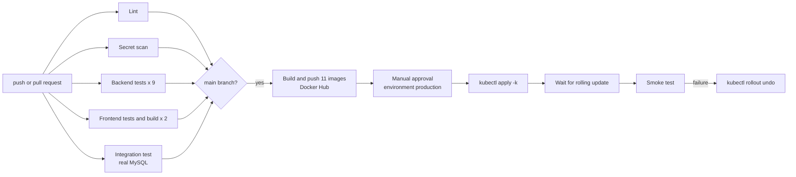

# CI/CD with GitHub Actions

## The pipeline (`.github/workflows/ci-cd.yml`)

| Job | What it does |
|---|---|
| lint | ESLint for backend, frontend and tests (one config at the repository root) |
| secrets-scan | Trivy looks for passwords and keys in the repository (it is public). Also a report-only configuration scan |
| backend (matrix of 9) | install, `prisma generate`, check that migrations are committed, `npm run build` (TypeScript), unit tests with coverage, `npm audit` report |
| frontend (matrix of 2) | install, unit and component tests, type check and production build |
| integration | Starts MySQL with Testcontainers and proves that stock is never oversold |
| publish (main only) | Builds each image and pushes it to Docker Hub with two tags: the commit SHA (the version) and `latest` |
| deploy (main only) | After approval: renders manifests for this commit, `kubectl apply -k`, waits for every Deployment, smoke test, automatic rollback on failure |

**Untested code is never deployed:** `publish` needs all test jobs, `deploy` needs `publish`, and `deploy` additionally needs a human approval.

## Second workflow: E2E (`.github/workflows/e2e.yml`)
Every night and on demand: starts the whole system with Docker Compose on a runner, creates the admin, and runs the end-to-end suite (including the bank-timeout test). Container logs are uploaded when it fails.

## One-time setup

1. **Commit the lock files.** Each service and app needs its `package-lock.json` in Git (`npm install` creates it). The pipeline uses `npm ci` when it exists.
2. **Commit the migrations.** `backend/<service>/prisma/migrations` must be in Git; the pipeline fails with a clear message otherwise.
3. **Docker Hub:** create an access token (Account settings > Security > New access token, permission Read and Write).
4. **GitHub repository secrets** (Settings > Secrets and variables > Actions > Secrets):
   - `DOCKERHUB_USERNAME`: your Docker Hub user name
   - `DOCKERHUB_TOKEN`: the access token (NOT your password)
   - `KUBE_CONFIG`: only when deploying to a remote cluster. Base64 of the kubeconfig file (PowerShell: `[Convert]::ToBase64String([IO.File]::ReadAllBytes("$HOME\.kube\config"))`)
5. **Repository variables** (same page, Variables tab):
   - `VITE_API_URL`: public address of the gateway that the React apps call (default `http://localhost:3000`)
   - `DEPLOY_RUNNER`: set to `self-hosted` to deploy to the Docker Desktop cluster on your own PC (see below). Leave it unset to use a GitHub runner and `KUBE_CONFIG`.
6. **Environment with approval:** Settings > Environments > New environment `production` > Required reviewers: add yourself. Optionally restrict it to the `main` branch. The deploy job pauses until you approve.
7. **Branch protection** (Settings > Branches > Add rule for `main`): require pull requests and the checks Lint, Backend, Frontend, Integration, Secrets scan.
8. **In the cluster, once:** create the Secret with `scripts\create-k8s-secret.ps1` (the pipeline never sees your passwords) and make sure the Kubernetes namespace exists.

## Deploying to the Docker Desktop cluster on your PC (self-hosted runner)
A GitHub runner cannot reach a cluster on your laptop, so install a runner on your PC:
Settings > Actions > Runners > New self-hosted runner > Windows. Run the commands GitHub shows (download, `config.cmd`, `run.cmd`).
The deploy job then uses your `kubectl` and your Docker Desktop context.

**Security warning:** a self-hosted runner executes workflow code on your PC. Never let it run code from pull requests of strangers:
this repository is public, so keep Settings > Actions > General > "Fork pull request workflows" on "Require approval for all outside collaborators", and note that only the `deploy` job uses the runner, and only on pushes to `main` after your approval.
For anything beyond a student demo use a remote cluster and `KUBE_CONFIG`.

## Image versions and rollback
Every image tag is a commit SHA, so a deployment can be traced to one commit. Roll back with `kubectl rollout undo deployment/<name> -n cake-shop`
(the pipeline does it for you when the smoke test fails) or re-run the workflow of an older commit.

## ESLint decisions
`no-explicit-any` is off because transactions (Prisma) and the AMQP library are typed loosely on purpose; unused variables are warnings; everything else from the recommended sets is on.
The React hooks rules are on for the front ends.

## Hardening ideas for later
Pin third-party actions to commit SHAs, scan the built images (Trivy image scan), sign images (cosign), use OIDC instead of long-lived cloud credentials, add Alertmanager.
